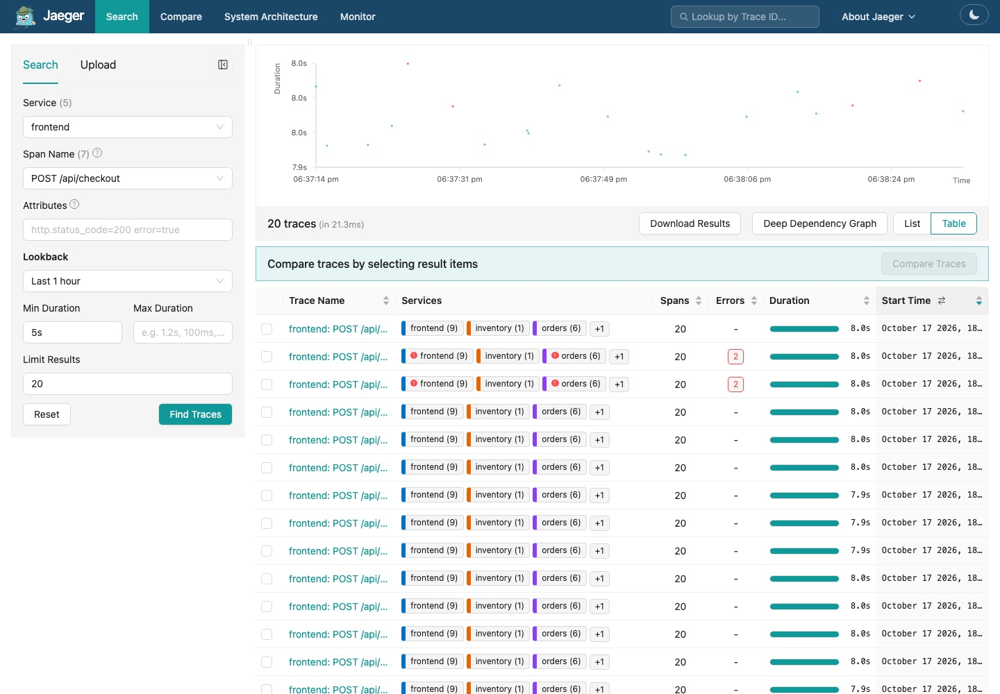

import { Aside, Tabs, TabItem } from '@astrojs/starlight/components';
import Terminal from '../../../../components/Terminal.astro';

**Goal:** every service exports traces, metrics and logs. Not one line of
application code changes.

## 2.1 What is already in the images

Each image contains the OpenTelemetry agent for its language. It sits there
doing nothing until the runtime is told to load it.

| Service | Language | Agent | Where | Docs |
|---------|----------|-------|-------|------|
| frontend | Node.js | [`@opentelemetry/auto-instrumentations-node`](https://www.npmjs.com/package/@opentelemetry/auto-instrumentations-node) | `node_modules` ([package.json](https://github.com/iblancasa/otel-workshop/blob/main/services/frontend/package.json)) | [Zero-code instrumentation for JavaScript](https://opentelemetry.io/docs/zero-code/js/) |
| orders, payments | Python | [`opentelemetry-distro`](https://pypi.org/project/opentelemetry-distro/) + instrumentation packages | `site-packages` ([requirements.txt](https://github.com/iblancasa/otel-workshop/blob/main/services/orders/requirements.txt)) | [Zero-code instrumentation for Python](https://opentelemetry.io/docs/zero-code/python/) |
| inventory | Java | [`opentelemetry-javaagent.jar`](https://github.com/open-telemetry/opentelemetry-java-instrumentation) | `/otel/` in the image ([Dockerfile](https://github.com/iblancasa/otel-workshop/blob/main/services/inventory/Dockerfile)) | [Java agent](https://opentelemetry.io/docs/zero-code/java/agent/) |

Which libraries each agent knows: [Node.js](https://github.com/open-telemetry/opentelemetry-js-contrib/tree/main/packages/auto-instrumentations-node#supported-instrumentations),
[Python](https://github.com/open-telemetry/opentelemetry-python-contrib/tree/main/instrumentation#readme),
[Java](https://github.com/open-telemetry/opentelemetry-java-instrumentation/blob/main/docs/supported-libraries.md).

Open
[server.js](https://github.com/iblancasa/otel-workshop/blob/main/services/frontend/server.js),
[app.py](https://github.com/iblancasa/otel-workshop/blob/main/services/orders/app.py) and
[Inventory.java](https://github.com/iblancasa/otel-workshop/blob/main/services/inventory/src/Inventory.java).
Search for `opentelemetry`. Nothing.

## 2.2 The switch is one variable per language

<Tabs syncKey="lang">
  <TabItem label="Node.js">
  ```yaml
  # preload the SDK before the application starts
  NODE_OPTIONS: "--require @opentelemetry/auto-instrumentations-node/register"
  ```
  </TabItem>
  <TabItem label="Python">
  ```yaml
  # the agent ships a sitecustomize.py; put its directory first on the path.
  # Exactly what `opentelemetry-instrument` and the OTel Operator do.
  PYTHONPATH: "/usr/local/lib/python3.12/site-packages/opentelemetry/instrumentation/auto_instrumentation"
  ```
  </TabItem>
  <TabItem label="Java">
  ```yaml
  # the JVM reads this variable and attaches the agent
  JAVA_TOOL_OPTIONS: "-javaagent:/otel/opentelemetry-javaagent.jar"
  ```
  </TabItem>
</Tabs>

Plus the standard variables every SDK understands, identical for the three
([common-otel-env.yaml](https://github.com/iblancasa/otel-workshop/blob/main/k8s/apps/instrumented/common-otel-env.yaml)).
They are specified once, in the
[SDK environment variables](https://opentelemetry.io/docs/specs/otel/configuration/sdk-environment-variables/)
and [OTLP exporter configuration](https://opentelemetry.io/docs/specs/otel/protocol/exporter/)
pages, and every language implements them:

```yaml
OTEL_SERVICE_NAME: frontend          # who am I
OTEL_EXPORTER_OTLP_ENDPOINT: http://otel-collector.observability.svc.cluster.local:4318
OTEL_EXPORTER_OTLP_PROTOCOL: http/protobuf
OTEL_RESOURCE_ATTRIBUTES: deployment.environment=workshop,k8s.pod.name=$(POD_NAME)  # POD_NAME via downward API
OTEL_SEMCONV_STABILITY_OPT_IN: http  # same metric names in all languages
OTEL_METRIC_EXPORT_INTERVAL: "5000"  # export every 5 s so the workshop feels live
```

Nothing in these variables mentions Jaeger, Prometheus or Loki. The apps
only know the Collector. The same overlay runs unchanged in the otelite
flavour.

They live in a kustomize overlay. The overlay is the base deployment plus
these variables, nothing else:

```bash
kubectl kustomize ../k8s/apps/instrumented | diff <(kubectl kustomize ../k8s/apps/base) -
```

## 2.3 Flip the switch

```bash
make instrument
```

<Terminal src="common/instrument" title="make instrument" />

Applies the overlay and waits for the deployments to roll. Java takes
longest: the agent rewrites bytecode at startup.

## 2.4 Verify

```bash
make logs-orders       # python logs now carry [trace_id=... span_id=...]
make logs-frontend     # winston JSON lines carry trace_id too
make logs-inventory    # "opentelemetry-javaagent - version: 2.31.1"
```

<Terminal src="common/logs-after" title="Trace ids in the logs" />

Then one backend per signal:

- **Jaeger** [localhost:16686](http://localhost:16686): reload. The
  **Service** dropdown now lists `frontend`, `orders`, `inventory`,
  `payments`. Pick `frontend`, **Find Traces**. Each result is a
  `POST /api/checkout` with the four services' colours. Click one: spans
  from four services, nested. Click a span: the **Tags** are the span
  attributes, the **Process** section is the resource (`service.name`,
  `k8s.pod.name`, `telemetry.sdk.language`). Nothing had to be copied.
- **Prometheus** [localhost:9090](http://localhost:9090): query
  `http_server_request_duration_seconds_count`. Four services, their
  routes and status codes, each its own series. Then `jvm_cpu_recent_utilization_ratio`
  and `nodejs_eventloop_utilization_ratio`.
- **Loki**, through Perses [localhost:3000](http://localhost:3000),
  **Explore**, logs: `{service_name="orders"}`. Expand a line: `severity_text`,
  `trace_id`, `span_id`, `code_function_name`, all there as structured
  metadata.
- **Perses** dashboard **slow-api**: the first row fills within a minute.
  The p95 is already telling you something.



<Terminal src="cncf/promql" title="Metric names and the checkout histogram, from the Prometheus API" />

## 2.5 What just happened

Each agent hooks into the libraries it knows: the HTTP server (Express,
FastAPI, the JDK HttpServer), the HTTP clients (`fetch`, `httpx`), the loggers
(winston, `logging`, `java.util.logging`). For every inbound request it starts
a **span**. For every outbound request it injects a `traceparent` header so
the next service continues the same **trace**. Log records get the current
trace and span id attached. The HTTP server hook also records a **histogram**
of request duration.

What you did not do: pick a tracing library, write middleware, propagate
headers, format log lines, expose a metrics endpoint, or tell any service
where Jaeger, Prometheus or Loki are.

<Aside type="caution" title="What the agents cannot do">
See inside your own functions. They know libraries, not your code. Keep that
in mind for step 3.
</Aside>

## Notes for the curious

- In Kubernetes you would not hand-write these env vars. The
  [OpenTelemetry Operator](https://opentelemetry.io/docs/platforms/kubernetes/operator/automatic/)
  injects them, and the agent itself, from one annotation on the pod. The
  mechanics are exactly what you just did.
- The metric and attribute names you see come from the
  [HTTP semantic conventions](https://opentelemetry.io/docs/specs/semconv/http/).
  `OTEL_SEMCONV_STABILITY_OPT_IN=http` selects the stable names in all three
  agents, see the [migration notes](https://opentelemetry.io/docs/specs/semconv/non-normative/http-migration/).
  Prometheus then applies its own naming on top; the mapping is in
  [The metrics, explained](/otel-workshop/cncf/reference/metrics/).
- Per-language configuration beyond the common variables:
  [Node.js](https://opentelemetry.io/docs/zero-code/js/configuration/),
  [Python](https://opentelemetry.io/docs/zero-code/python/configuration/),
  [Java](https://opentelemetry.io/docs/zero-code/java/agent/configuration/).
- The readiness probes use `tcpSocket` instead of HTTP on purpose. HTTP
  probes would create a trace every few seconds. In production you filter
  those in the Collector or with `OTEL_PYTHON_EXCLUDED_URLS` and friends.
- FastAPI 0.14x ships its own OpenTelemetry integration. Combined with the
  agent it exports everything twice. The workshop pins FastAPI 0.115. With a
  newer one, pass `telemetry={"auto_configure": False}` to `FastAPI()` or
  drop the agent.
