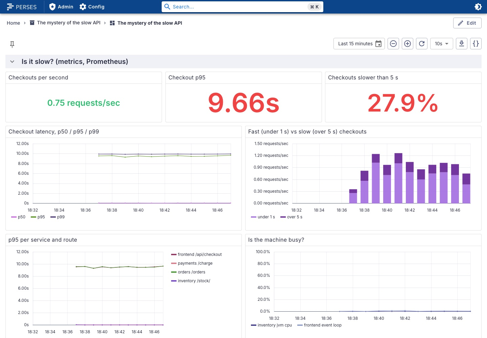
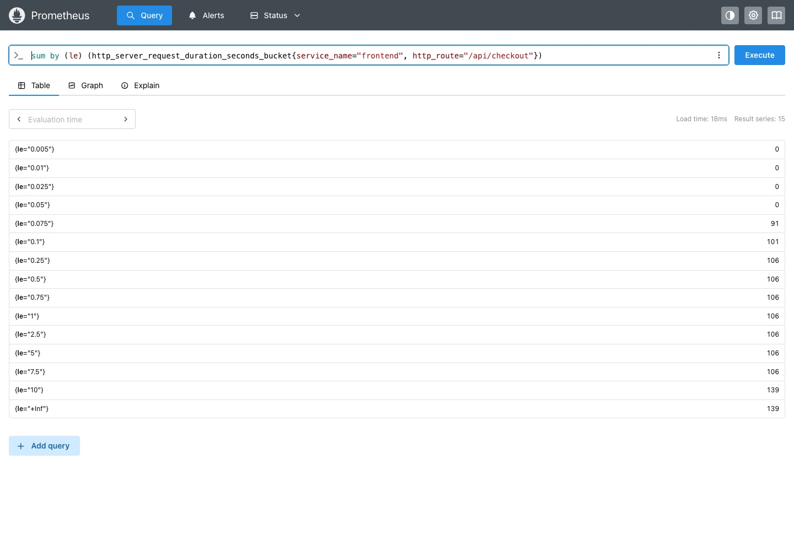
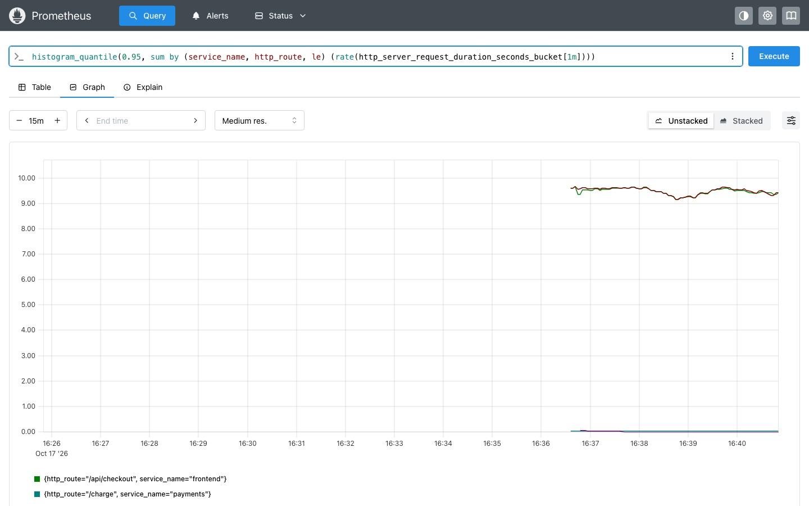
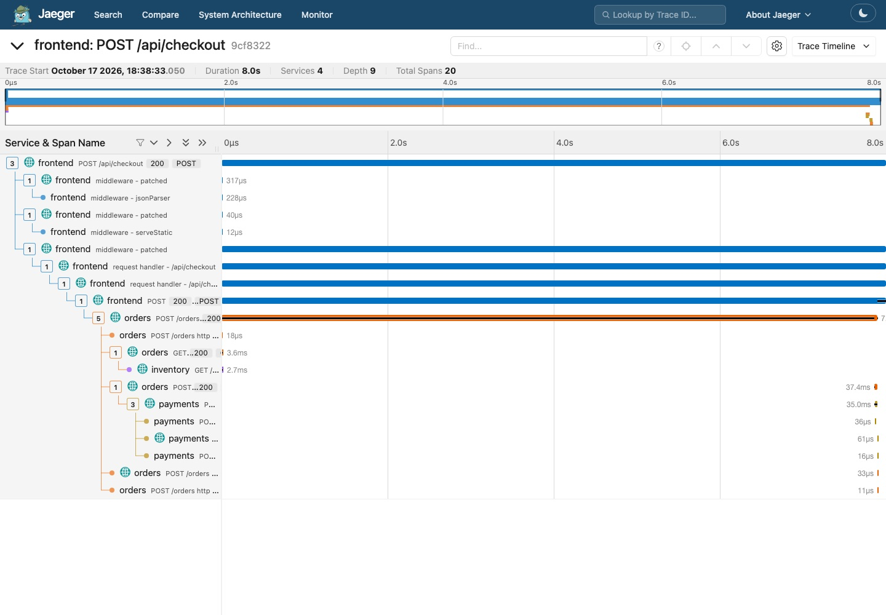
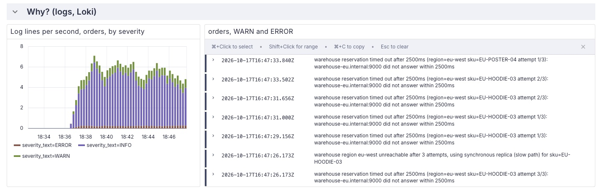

import { Aside, Steps } from '@astrojs/starlight/components';
import Terminal from '../../../../components/Terminal.astro';

**Goal:** go from "users say it is slow" to the root cause, using each
signal for what it is good at, in the tool built for it.

- A **metric** tells you *that* something is wrong, and how bad. Prometheus.
- A **trace** tells you *where*: which service, which call. Jaeger.
- A **log** tells you *why*: what the code was thinking at that moment. Loki.

## 3.1 The metric: is it really slow?

Two ways to look. The dashboard first:
[localhost:3000](http://localhost:3000), project **The mystery of the slow
API**, dashboard **slow-api**, row **Is it slow?**.

- **Checkout p95**: around 8 s, red. **Checkouts slower than 5 s**: about
  25 percent. The **Checkouts per second** stat is steady.
- **Checkout latency, p50 / p95 / p99**: p50 sits around 60 ms, p95 and p99
  at 8 s. The median user is fine. One in four is not. The mean, which is
  what most people look at, would say "2 seconds, meh".
- **Fast vs slow**: two bars, nothing in between. Bimodal means it is not a
  saturated resource. Saturation smears the whole distribution to the
  right. Something costs a fixed 8 s, or it does not.
- **p95 per service and route**: `frontend /api/checkout` and
  `orders /orders` are slow together. `inventory /stock/` and
  `payments /charge` never leave the millisecond range.
- **Is the machine busy?**: JVM CPU and the Node.js event loop both near
  zero. Welcome to the mystery.



Now the same thing by hand, because the dashboard is only three queries
you should be able to write. [localhost:9090](http://localhost:9090),
**Query**:

```text title="PromQL"
# p95 of the checkout, per minute
histogram_quantile(0.95, sum by (le) (rate(http_server_request_duration_seconds_bucket{service_name="frontend", http_route="/api/checkout"}[1m])))

# the raw cumulative buckets: count of requests that took <= le seconds
sum by (le) (http_server_request_duration_seconds_bucket{service_name="frontend", http_route="/api/checkout"})

# p95 per service and route
histogram_quantile(0.95, sum by (service_name, http_route, le) (rate(http_server_request_duration_seconds_bucket[1m])))
```



Run the second one in the **Table** view. The counts climb between
`le="0.05"` and `le="0.1"`, stay flat all the way to `le="5"`, then jump at
`le="10"`. Every fast request takes 50 to 100 ms, every slow one lands
between 7.5 and 10 seconds, nothing in between. That is the whole story in
one table.



The metric points a finger, but it only knows the HTTP server side of each
service. For the chain of calls you need a trace.

## 3.2 The trace: who is slow?

[localhost:16686](http://localhost:16686). In the search form: **Service**
`frontend`, **Operation** `POST /api/checkout`, **Min Duration** `5s`,
**Find Traces**. Every result is around 7.9 s. The scatter plot above the
list shows the two groups again, if you clear the Min Duration. Click one.


The waterfall, top to bottom:

```
POST /api/checkout            frontend   7910 ms   <- the button
  middleware - ...            frontend            (Express internals, noise)
  POST                        frontend   7908 ms   <- outgoing call to orders
    POST /orders              orders     7752 ms   <- orders handling it
      GET                     orders        4 ms   <- outgoing call to inventory
        GET /stock/           inventory     3 ms   <- inventory answering
      POST                    orders       35 ms   <- outgoing call to payments
        POST /charge          payments     32 ms   <- payments answering
```

Read it like this:

- frontend waits 7.9 s for orders. Frontend is innocent.
- orders spends 7.75 s. Of that, 4 ms is the call to inventory and 35 ms the
  call to payments.
- inventory and payments are innocent. The `cache miss` logs were a red herring.
- **7.7 seconds happen inside orders, between the inventory call and the
  payments call, with no span for them.** Auto-instrumentation shows network
  boundaries. Whatever orders does in between is invisible.



Click the `POST /orders` span. **Tags**: `http.route=/orders`,
`http.response.status_code=200`, `server.address`, and
`otel.scope.name=opentelemetry.instrumentation.fastapi`, which tells you
which agent produced it. **Process**: `service.name=orders`, `k8s.pod.name`,
`telemetry.sdk.language=python`. Status OK. From the outside, everything is
fine.

The trace id is in the page header. Copy it.

<Terminal src="cncf/jaeger-api" title="Slow traces via the Jaeger API" />

Two options now: read the orders code (small here, 40k lines and three teams
in real life), or ask the logs what happened in that exact request.

## 3.3 The log: why?

Perses, **Explore**, logs, datasource `loki`:

```text title="LogQL"
{service_name=~".+"} | trace_id="<the id you copied>"
```

`trace_id` is not in the log line. It is structured metadata Loki attached
when the OTLP record came in, and LogQL filters on it like a label. For a
slow trace, from orders, in order:

```
INFO  new order request sku=EU-HOODIE-03 qty=1
INFO  HTTP Request: GET http://inventory:8081/stock/EU-HOODIE-03 "HTTP/1.1 200 OK"
WARN  warehouse reservation timed out after 2500ms (region=eu-west sku=EU-HOODIE-03 attempt 1/3): warehouse-eu.internal:9000 did not answer within 2500ms
WARN  warehouse reservation timed out after 2500ms (region=eu-west sku=EU-HOODIE-03 attempt 2/3): ...
WARN  warehouse reservation timed out after 2500ms (region=eu-west sku=EU-HOODIE-03 attempt 3/3): ...
ERROR warehouse region eu-west unreachable after 3 attempts, using synchronous replica (slow path) for sku=EU-HOODIE-03
INFO  order 5f75ec9a confirmed sku=EU-HOODIE-03 region=eu-west mode=fallback
```

And from frontend, same trace id: `checkout started`, `checkout was slow
ms=7912`, `checkout completed`.

<Terminal src="cncf/logql" title="All logs of one trace, via the Loki API" />

There it is. 3 attempts × 2.5 s timeout + 400 ms fallback = 7.9 s. The EU
warehouse endpoint is dead. The client retries three times with a long
timeout, falls back, and the order succeeds. HTTP 200. Nobody is paged.

Compare with a fast trace: `reserved US-MUG-02 x1 at us-east (attempt 1)`.
One attempt, 20 ms.

## 3.4 Confirm it is systemic

Same Explore page, or the dashboard row **Why?**:

```text title="LogQL"
{service_name="orders"} | severity_text="ERROR"
```

Every error is the same message, every one is `region=eu-west`. Then count
them:

```text title="LogQL"
sum by (severity_text) (count_over_time({service_name="orders"} | severity_text != "" [5m]))
```



Three WARN per ERROR, exactly. Nothing else is wrong in the system.
Full-text search works too: `{service_name="orders"} |= "eu-west"`.

## 3.5 What we learned

| Signal | Tool | Question it answered | What it could not tell us |
|--------|------|---------------------|---------------------------|
| metric | Prometheus | Is it slow? For how many? Since when? | Which call. Why. |
| trace | Jaeger | Which service, which call, how the time splits | What happened inside the gap |
| log | Loki | Why: timeouts, retries, fallback, config values | How often, across all users, without grepping |

The trace id ties them together. Without it you would be grepping timestamps
across three services and guessing. You copied it by hand from Jaeger into
a LogQL query; in production the dashboard tool links them for you (Perses
and Grafana both can), but the mechanism is the same.

One thing still bothers us: the 7.7 s gap in the trace. The logs explained
it. We would prefer the trace to show it. That is step 4.

<Aside type="tip" title="Terminal people">
All three tools have an HTTP API, and
[cncf/scripts/api-helpers.py](https://github.com/iblancasa/otel-workshop/blob/main/cncf/scripts/api-helpers.py)
formats their answers:

```bash
curl -s localhost:9090/api/v1/query --data-urlencode 'query=sum by (le) (http_server_request_duration_seconds_bucket{service_name="frontend",http_route="/api/checkout"})' | python3 scripts/api-helpers.py buckets
curl -s -G localhost:16686/api/v3/trace-summaries --data-urlencode query.service_name=frontend --data-urlencode query.duration_min=5s --data-urlencode "query.start_time_min=$(date -u -v-30M +%Y-%m-%dT%H:%M:%SZ)" --data-urlencode "query.start_time_max=$(date -u +%Y-%m-%dT%H:%M:%SZ)" | python3 scripts/api-helpers.py summaries
curl -s -G localhost:3100/loki/api/v1/query_range --data-urlencode 'query={service_name=~".+"} | trace_id="<id>"' --data-urlencode since=1h | python3 scripts/api-helpers.py loglines
```

On Linux, `date -u -d '30 min ago' +%Y-%m-%dT%H:%M:%SZ` instead of `-v-30M`.
</Aside>
