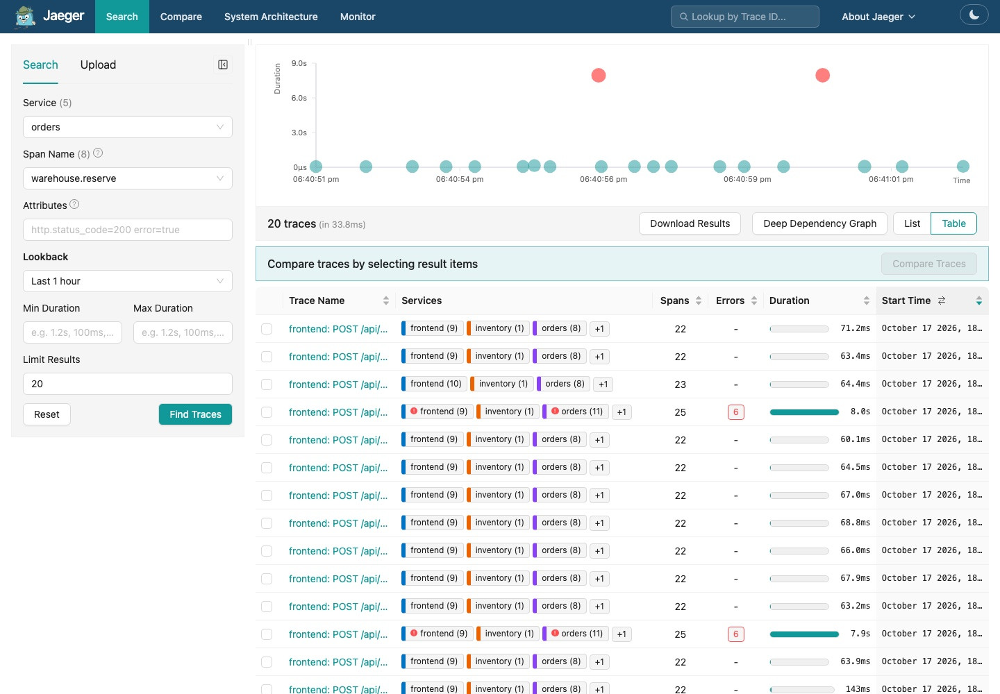
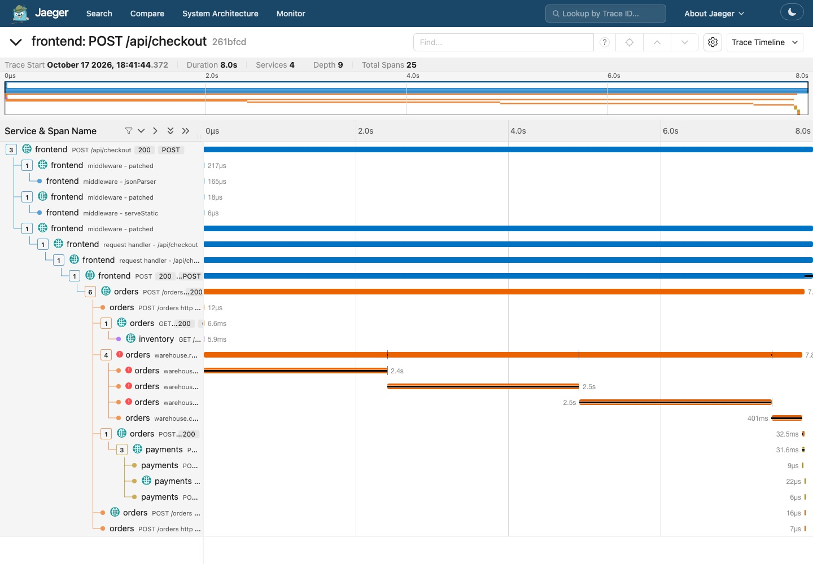

import { Aside, Tabs, TabItem } from '@astrojs/starlight/components';
import Terminal from '../../../../components/Terminal.astro';

**Goal:** the gap inside `POST /orders` gets its own spans, with attributes
and an error status. This is the one step where you edit code.

## 4.1 Where the time goes

Open
[services/orders/warehouse.py](https://github.com/iblancasa/otel-workshop/blob/main/services/orders/warehouse.py).
The function `reserve()` is the whole mystery: a retry loop around a "legacy"
client no instrumentation library knows about. There is a `TODO` marker.

Auto-instrumentation gave you 90 percent for free. The last 10 percent, the
business logic specific to your service, is yours. Three things to add:

1. A span around the operation.
2. Attributes with the values you would otherwise grep for in logs.
3. An error status, and the exception, when it goes wrong.

## 4.2 Write it

The OpenTelemetry API is already installed, the agent depends on it. You only
import the API, never the SDK
([Python manual instrumentation docs](https://opentelemetry.io/docs/languages/python/instrumentation/)). If the agent is not loaded, the API is a no-op
and your code still runs.

```python title="services/orders/warehouse.py" ins={1-2,4}
from opentelemetry import trace
from opentelemetry.trace import Status, StatusCode

tracer = trace.get_tracer("orders.warehouse")
```

Then wrap `reserve()`:

```python title="services/orders/warehouse.py" {4-9,15-16,22,28-31}
def reserve(sku: str, qty: int) -> Reservation:
    region = region_for(sku)

    with tracer.start_as_current_span("warehouse.reserve") as span:
        span.set_attribute("warehouse.region", region)
        span.set_attribute("warehouse.sku", sku)
        span.set_attribute("warehouse.timeout_ms", TIMEOUT_MS)
        span.set_attribute("warehouse.max_retries", RETRIES)
        last_exc = None

        attempt = 0
        while True:
            attempt += 1
            try:
                with tracer.start_as_current_span("warehouse.call_primary") as call:
                    call.set_attribute("warehouse.attempt", attempt)
                    _call_primary(region, sku, qty)
                log.info("reserved %s x%d at %s (attempt %d)", sku, qty, region, attempt)
                return Reservation(sku=sku, qty=qty, region=region, mode="primary")
            except WarehouseTimeout as exc:
                last_exc = exc
                span.add_event("warehouse.timeout", {"attempt": attempt})
                log.warning("warehouse reservation timed out ...", ...)
                if attempt >= RETRIES:
                    break

        log.error("warehouse region %s unreachable ...", region, ...)
        span.record_exception(last_exc)
        span.set_status(Status(StatusCode.ERROR, f"{region} unreachable, used fallback"))
        span.set_attribute("warehouse.mode", "fallback")
        with tracer.start_as_current_span("warehouse.call_fallback"):
            _call_fallback(region, sku, qty)
        return Reservation(sku=sku, qty=qty, region=region, mode="fallback")
```

The complete file is in
[solutions/orders/warehouse.py](https://github.com/iblancasa/otel-workshop/blob/main/solutions/orders/warehouse.py).
Short on time: `cp ../solutions/orders/warehouse.py ../services/orders/`.

<Aside type="tip" title="Four rules">
- Span names are low cardinality: `warehouse.reserve`, never
  `reserve EU-HOODIE-03`. The SKU goes in an attribute. Jaeger's Operation
  dropdown and the `span_metrics` connector both key on the name.
- Attribute names use dots and a namespace: `warehouse.region`. Check the
  [semantic conventions](https://opentelemetry.io/docs/specs/semconv/) first;
  db, messaging, rpc, exceptions already have standard names.
- Inner `with` blocks become child spans. No ids to pass around.
- `record_exception` + `set_status(ERROR)` is what turns a span red in every
  backend. Logging the exception alone does not.
</Aside>

## 4.3 Ship it

```bash
make rebuild-orders
```

Rebuilds the image, loads it into kind, restarts the deployment. About 30 s.

<Terminal src="common/rebuild" title="make rebuild-orders" />

## 4.4 Look at the trace now

Jaeger, search **Service** `orders`. The **Operation** dropdown has three
new entries: `warehouse.reserve`, `warehouse.call_primary`,
`warehouse.call_fallback`. Pick `warehouse.reserve`, **Find Traces**. Every
EU order now carries a red error marker in the list. Open one. The gap is
gone:



```
POST /orders                         orders   7790 ms
  GET /stock/...                     orders      4 ms
  warehouse.reserve        ERROR     orders   7790 ms   region=eu-west sku=EU-POSTER-04 max_retries=3 mode=fallback
    warehouse.call_primary ERROR     orders   2500 ms   attempt=1   WarehouseTimeout: warehouse-eu.internal:9000 ...
    warehouse.call_primary ERROR     orders   2500 ms   attempt=2
    warehouse.call_primary ERROR     orders   2500 ms   attempt=3
    warehouse.call_fallback          orders    400 ms
```

<Terminal src="cncf/jaeger-spans" title="The same trace from the API: service, duration, status, name" />



Click `warehouse.reserve`. **Tags**: `warehouse.region`, `warehouse.sku`,
`warehouse.mode=fallback`, `error=true`, `otel.status_code=ERROR`,
`otel.status_description`. **Logs** (Jaeger's name for span events): three
`warehouse.timeout` events with their `attempt`, and one `exception` event
with `exception.type`, `exception.message` and the stack trace. Every span
with status ERROR is drawn red; the whole trace gets the marker.

No log reading needed. The trace is the story. Logs keep their value: cheaper,
they survive sampling, they are what you have for code nobody instrumented
yet. For this bug, one click is enough.

## 4.5 The new span is a metric too

The `span_metrics` connector counts every span by name and status. In
Prometheus:

```text title="PromQL"
sum by (span_name, status_code) (rate(traces_span_metrics_calls_total{service_name="orders", span_name=~"warehouse.*"}[5m]))
```

`warehouse.call_primary` with `status_code="STATUS_CODE_ERROR"` is three
times the rate of `warehouse.reserve`. An alert on the error rate of
`warehouse.reserve` would have fired days ago; an alert on HTTP 5xx never
would. You did not add a counter to the code. You added a span and the
Collector did the rest.

## 4.6 Same idea in the other two languages

<Tabs syncKey="lang">
  <TabItem label="Node.js">
  ```js
  const { trace, SpanStatusCode } = require("@opentelemetry/api");
  const tracer = trace.getTracer("frontend");

  await tracer.startActiveSpan("cart.price", async (span) => {
    try {
      span.setAttribute("cart.items", n);
      // ...
    } catch (e) {
      span.recordException(e);
      span.setStatus({ code: SpanStatusCode.ERROR });
      throw e;
    } finally {
      span.end();
    }
  });
  ```
  </TabItem>
  <TabItem label="Java">
  ```java
  // opentelemetry-api on the classpath; the agent provides the SDK
  Tracer tracer = GlobalOpenTelemetry.getTracer("inventory");
  Span span = tracer.spanBuilder("stock.lookup").startSpan();
  try (Scope s = span.makeCurrent()) {
      span.setAttribute("stock.sku", sku);
      // ...
  } catch (Exception e) {
      span.recordException(e);
      span.setStatus(StatusCode.ERROR);
      throw e;
  } finally {
      span.end();
  }
  ```
  With the agent, `@WithSpan` on the method and `@SpanAttribute` on
  parameters do the same with zero boilerplate
  ([annotations docs](https://opentelemetry.io/docs/zero-code/java/agent/annotations/)).
  Manual instrumentation docs: [Node.js](https://opentelemetry.io/docs/languages/js/instrumentation/),
  [Java](https://opentelemetry.io/docs/languages/java/instrumentation/).
  </TabItem>
</Tabs>
