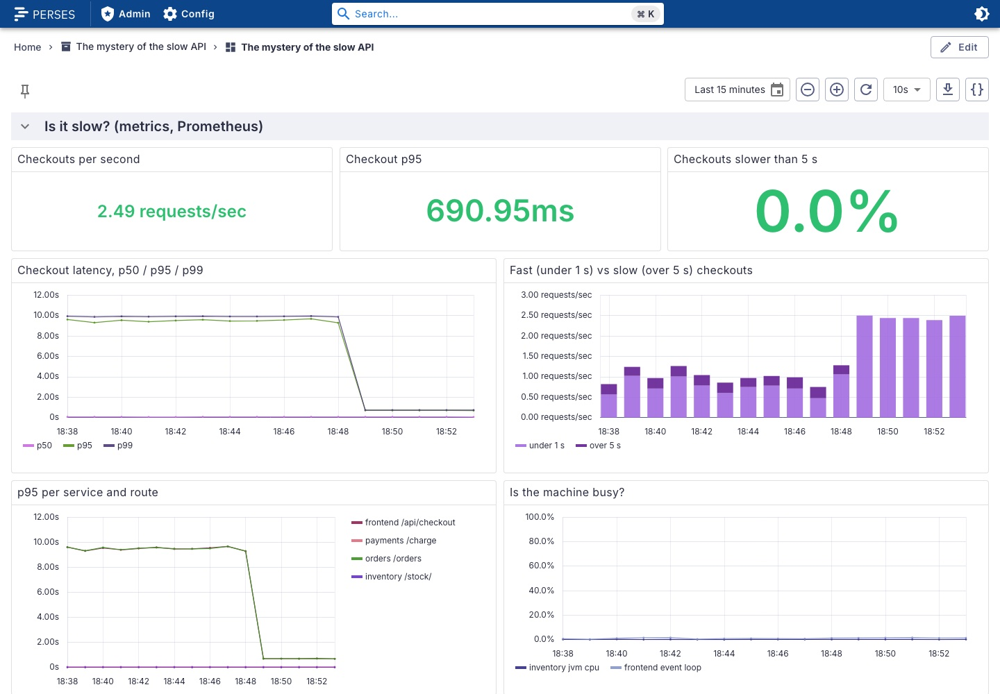
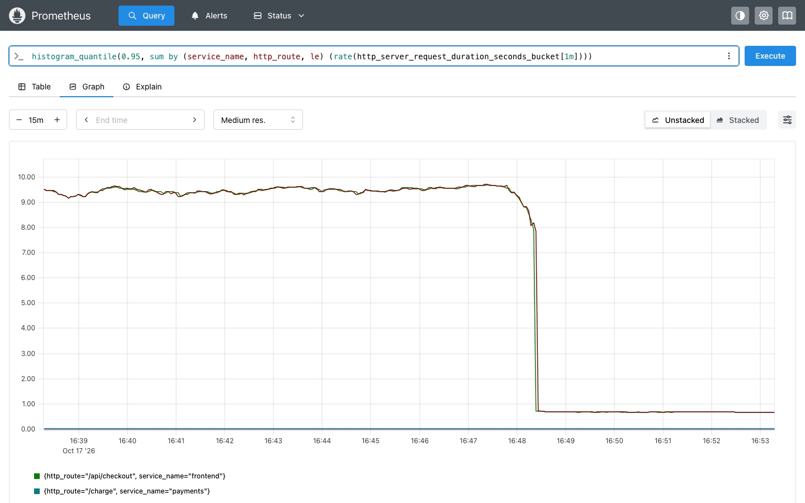
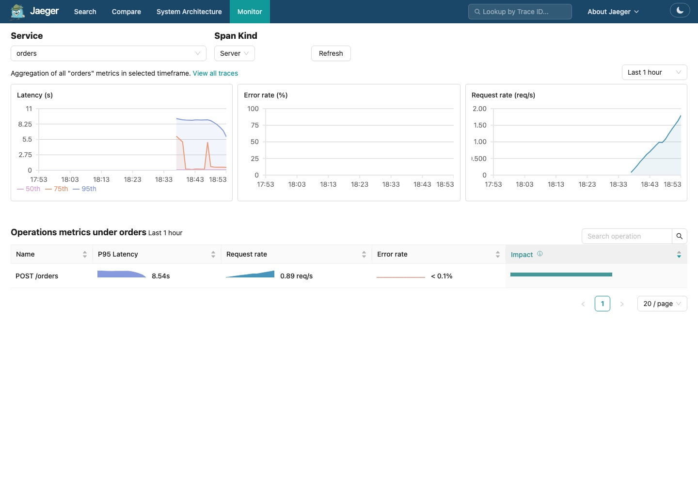

import { Aside } from '@astrojs/starlight/components';
import Terminal from '../../../../components/Terminal.astro';

**Goal:** apply a mitigation, then prove with metric, trace and log that it
worked.

## 5.1 What is the actual fix?

The EU warehouse endpoint is dead. Three things are wrong, in order of how
fast you can fix them:

1. **Retry policy.** 3 attempts with a 2.5 s timeout before giving up means
   every EU order burns 7.9 s to end up in the fallback anyway. Fail fast.
2. **Observability.** Nobody noticed for days because the request returns
   200. An error-rate alert on HTTP status would never fire. A latency SLO on
   p95 would have. The `warehouse.reserve` span from step 4 now gives you an
   error rate to alert on, and Prometheus is where that alert would live.
3. **The endpoint.** Somebody has to fix `warehouse-eu.internal`. Different
   team, different day.

We do number 1, the on-call mitigation. The warehouse client reads its
settings from the environment, so no rebuild:

```bash
make fix
```

which runs

```bash
kubectl -n shop set env deploy/orders WAREHOUSE_TIMEOUT_MS=250 WAREHOUSE_RETRIES=1
```

<Terminal src="common/fix" title="make fix, then one EU checkout" />

| | before | after |
|---|---|---|
| attempts × timeout | 3 × 2500 ms | 1 × 250 ms |
| fallback replica | 400 ms | 400 ms |
| EU checkout | ~7.9 s | ~0.65 s |

Still a fallback, still logged as an error, still a red span. The user just
stops paying 7.5 s for retries that never succeed.

## 5.2 Prove it with the metric

Perses dashboard, row **Is it slow?**, wait a minute:

- **Checkout p95** goes from 8 s to about 0.65 s and turns amber.
- **Checkouts slower than 5 s** falls to zero as the 5 minute window moves.
- **Fast vs slow**: the red bar stops. Everything is now in the fast
  series, because 0.65 s is under the 1 s bucket.
- **p50 / p95 / p99**: p95 and p99 drop together. The line is the chart you
  paste in the incident channel.



In Prometheus, every query of step 3 works unchanged. `rate()` looks at
increases, so the quantile and the fast/slow bars follow the fix as the
window moves. The raw cumulative bucket table is different: the frontend
pod never restarted, so its counters still hold the old 7.5 to 10 s group.
Run it again and watch: the `le="10"` count stops growing while `le="0.75"`
starts climbing. Cumulative histograms remember; rates forget. Both are
right.



One timing detail: the first EU checkout right after `make fix` can still
take 8 s. The frontend keeps a keep-alive connection to the old orders pod
while it drains. The second one is fast.

## 5.3 Prove it with a trace

Jaeger, **Service** `orders`, **Operation** `warehouse.reserve`, a fresh
trace:

```
warehouse.reserve         ERROR   650 ms   region=eu-west mode=fallback max_retries=1
  warehouse.call_primary  ERROR   250 ms   attempt=1
  warehouse.call_fallback         400 ms
```

Still an error, the warehouse is still down. A cheap one. The error marker
stays in the list, which is correct: an alert on it should keep firing
until someone fixes the endpoint.

Jaeger's **Monitor** tab tells the same story without opening a single
trace: the p95 of `POST /orders` falls off a cliff at the minute of the fix.



## 5.4 Prove it with the logs

Perses, Explore, logs:

```text title="LogQL"
{service_name="orders"} | severity_text=~"WARN|WARNING"
```

```
warehouse reservation timed out after 250ms (region=eu-west sku=EU-POSTER-04 attempt 1/1)
```

<Terminal src="common/logs-fixed" title="One warning per EU order, 250 ms" />

One warning per EU order instead of three, `250ms` instead of `2500ms`. The
ERROR line is still there. Someone should still fix the endpoint. The
dashboard row **Why?** shows the WARN rate drop to a third.

## 5.5 Replay

```bash
make unfix     # 2500 ms, 3 retries again
make reset     # back to step 0: no instrumentation, broken, Jaeger, Prometheus and Loki wiped
```

<Aside type="note" title="What to take home">
- Three signals, three questions: *is it slow* (metric), *where* (trace),
  *why* (log). The trace id is the glue, whichever tools you use.
- Auto-instrumentation is an environment variable per language. Start there.
  Add your own spans where the agents cannot see.
- Returning 200 after a fallback hides outages. Record errors on spans even
  when the request "succeeds", and alert on span error rates, not only on
  HTTP status.
- The apps never learned the names Jaeger, Prometheus or Loki. Swap any of
  the four for your vendor and only the Collector config changes.
</Aside>
