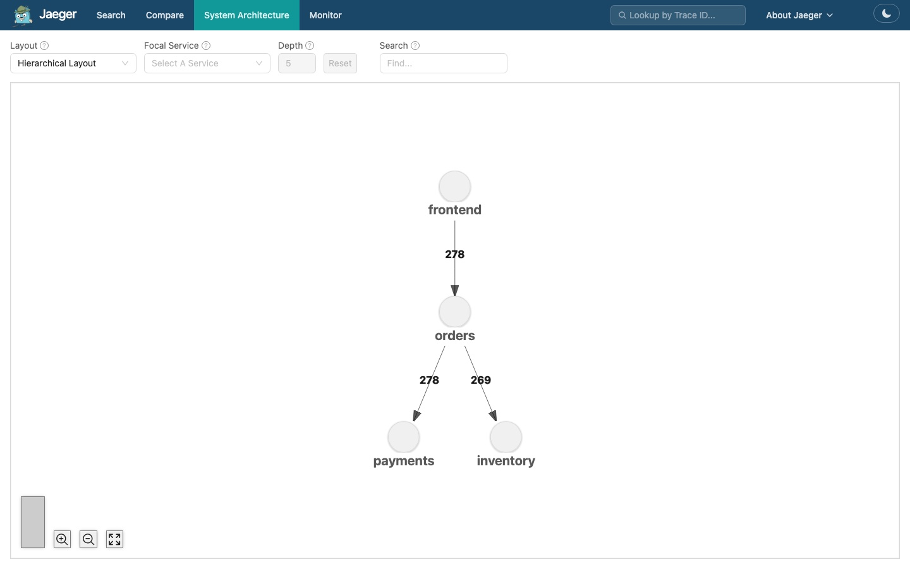
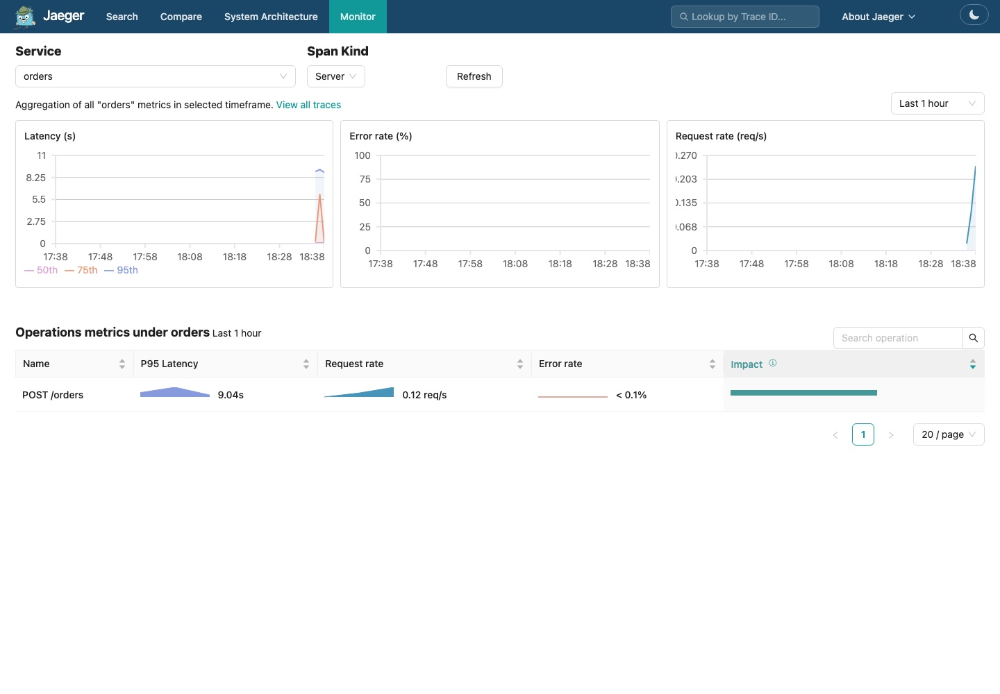
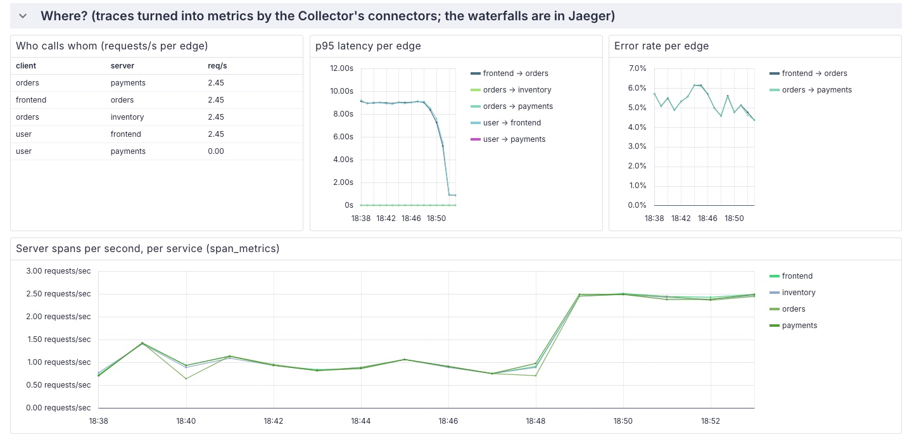

import { Aside } from '@astrojs/starlight/components';
import Terminal from '../../../../components/Terminal.astro';

**Goal:** a picture of who calls whom, with request rate, error rate and
latency on every arrow, without anyone drawing it by hand. This flavour has
three of them, each made differently.

## 6.1 Jaeger: System Architecture

[localhost:16686](http://localhost:16686), top menu **System Architecture**.
Five nodes, four arrows: `frontend` to `orders`, `orders` to `inventory`,
`orders` to `payments`, plus `jaeger` on its own. Hover an arrow for the
call count. The **DAG** view lays it out top to bottom, **Force Directed
Graph** lets you drag.



Where does it come from? Every stored trace is a tree. For every span whose
parent belongs to another service, Jaeger records one dependency link. The
memory store computes this on the fly from the traces it holds, so the
graph is exactly what happened in the last hour of traffic, nothing more.
A disk-backed store would need a periodic job to aggregate links.

From the terminal:

```bash
curl -s "localhost:16686/api/dependencies?endTs=$(date +%s)000&lookback=3600000" \
  | python3 -c 'import sys,json; [print(d["parent"], "->", d["child"], d["callCount"]) for d in json.load(sys.stdin)["data"]]'
```

This map has no latency and no errors on it. For those, Jaeger needs
metrics.

## 6.2 Jaeger: Monitor

Top menu **Monitor**, service `orders`. Three charts: **Latency** (p50,
p75, p95), **Request rate**, **Error rate**, and a table with the same
numbers per operation. Before step 5 the p95 of `POST /orders` sits at
8 s; after, at 0.65 s. This is Jaeger's
[Service Performance Monitoring](https://www.jaegertracing.io/docs/latest/architecture/spm/)
and it is not computed by Jaeger at all.



The `span_metrics` connector in the Collector counts and times every span
and emits two metrics, which land in Prometheus through the same OTLP
path as the apps' own metrics:

| Metric | Type | Dimensions |
|--------|------|------------|
| `traces_span_metrics_calls_total` | counter | `service_name`, `span_name`, `span_kind`, `status_code`, plus `http_request_method`, `http_route`, `http_response_status_code` when the span has them |
| `traces_span_metrics_duration_milliseconds` | histogram | same, with the `le` buckets of the Collector config |

Jaeger's Monitor tab runs PromQL against them. The relevant part of
[jaeger-config.yaml](https://github.com/iblancasa/otel-workshop/blob/main/cncf/k8s/stack/jaeger-config.yaml):

```yaml
metric_backends:
  prometheus_store:
    prometheus:
      endpoint: http://prometheus.observability.svc.cluster.local:9090
      normalize_calls: true      # look for calls_total, not calls
      normalize_duration: true   # look for duration_milliseconds_bucket, not duration_bucket
```

The Monitor tab shows server spans. The spans you added in step 4 are
internal, so they are not in the table, but they are in Prometheus, which
is the point of the next section.

## 6.3 Prometheus and Perses: the `service_graph` connector

The third map is the one the otelite flavour needed a fork for. The
[`service_graph` connector](https://github.com/open-telemetry/opentelemetry-collector-contrib/tree/main/connector/servicegraphconnector)
pairs each client span with the server span it caused, across all traces,
and emits one series per edge:

```yaml title="otel-collector-config.yaml (the connector part)"
connectors:
  service_graph:
    metrics_flush_interval: 10s
    store: { ttl: 10s, max_items: 5000 }
    latency_histogram_buckets: [10ms, 50ms, 100ms, 250ms, 500ms, 1s, 2.5s, 5s, 10s]
    virtual_node_peer_attributes: [peer.service, server.address, net.peer.name, db.name, db.system]

service:
  pipelines:
    traces:
      exporters: [otlp/jaeger, span_metrics, service_graph]   # traces also go into both connectors
    metrics:
      receivers: [otlp, span_metrics, service_graph]          # ...which emit metrics here
      exporters: [otlphttp/prometheus]
```

| Metric (as Prometheus names it) | Type | Meaning |
|--------|------|---------|
| `traces_service_graph_request_total` | counter | requests from `client` to `server` |
| `traces_service_graph_request_failed_total` | counter | of which failed (span status ERROR) |
| `traces_service_graph_request_server_seconds` | histogram | latency as seen by the server |
| `traces_service_graph_request_client_seconds` | histogram | latency as seen by the client |

Perses dashboard, row **Where?**:

- **Who calls whom**: a table, one row per edge, requests per second. Four
  rows: `user → frontend`, `frontend → orders`, `orders → inventory`,
  `orders → payments`. A fifth, `user → payments` at 0 req/s, can linger
  from the rollout of step 2: for a few seconds the old orders pod called
  the new payments pod without a client span, so the connector invented a
  caller. `make reset` restarts the Collector and forgets it. `user` is not a service: the connector invents a
  virtual client for server spans that have no caller, which is what a
  browser or the load generator looks like from inside the cluster.
- **p95 latency per edge**: before the fix, `frontend → orders` at 8 s
  while `orders → inventory` stays at 5 ms. Same conclusion as step 3, zero
  clicks. After the fix, 0.65 s.
- **Error rate per edge**: `frontend → orders` and `orders → payments` carry
  the declined cards: about 6 percent of charges come back `402 card
  declined` (three posters on one card trip the per-order limit). A 4xx on
  a client span is an error in OpenTelemetry's HTTP conventions, so the
  connector counts it as failed, one hop up as well. `user → frontend` stays
  at zero because the frontend answers the browser with a proper 402, which
  is not an error for a server span.
- The slow warehouse never shows as an error here, before or after step 4.
  `warehouse.reserve` is an internal span, not a client/server pair, and the
  connector only pairs those. If the warehouse were a real remote call with
  a failing client span, a virtual `warehouse-eu.internal` node would
  appear with a red edge.

<Terminal src="cncf/service-graph" title="The edges straight from Prometheus" />



Perses has no node-graph panel, so the edges are a table and two charts.
Grafana's Node Graph panel and Jaeger's dependency view draw these as
arrows; the data is the same.

## 6.4 Why this matters

- **Topology for free.** Nobody maintains an architecture diagram. The graph
  is whatever the traces say it is, right now.
- **Blast radius.** Everything upstream of a node before you restart it.
- **Virtual nodes.** Calls to things nobody instrumented (databases, SaaS
  APIs, that one Perl service) still show up, inferred from the client
  span's `peer.service`, `db.name` or `db.system`.
- **Three sources, one truth.** Jaeger's map comes from stored traces, the
  Monitor tab and the Perses row from metrics the Collector derived from
  the same traces before they were stored. Sampling the traces would thin
  the first and leave the other two exact, because the connectors see every
  span.

<Aside type="note" title="Caveats, stated plainly">
- The `service_graph` connector needs both halves of an edge in the same
  Collector instance. With several Collectors behind a load balancer, pair
  them with the `loadbalancing` exporter first, keyed by trace id.
- Spans older than `store.ttl` that never found their pair are dropped and
  counted in `traces_service_graph_unpaired_spans_total`. Long-running
  requests need a longer TTL.
- Jaeger's memory store forgets everything on restart, and so does the
  dependency graph. `make reset` does exactly that on purpose.
</Aside>
