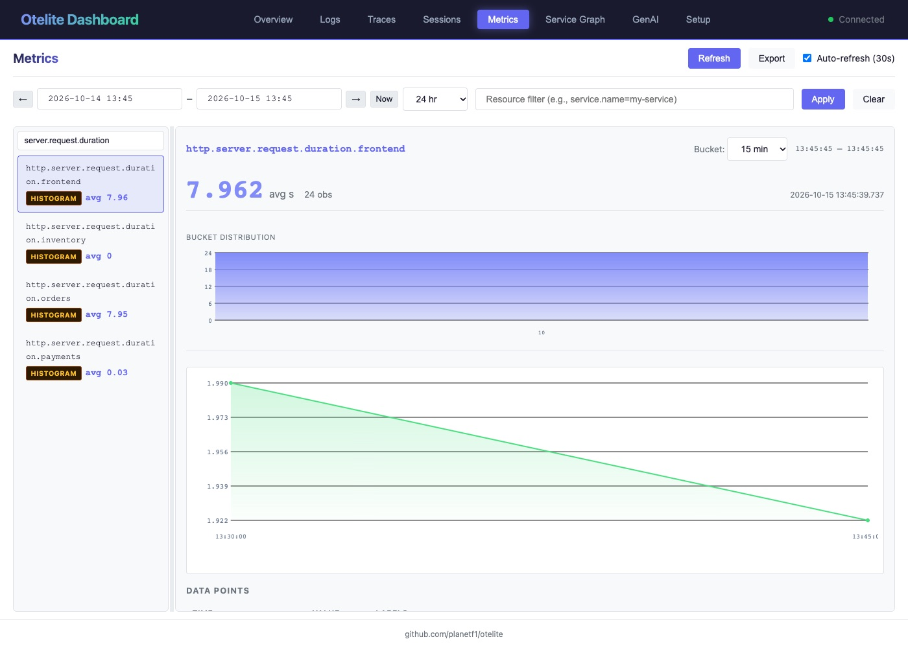
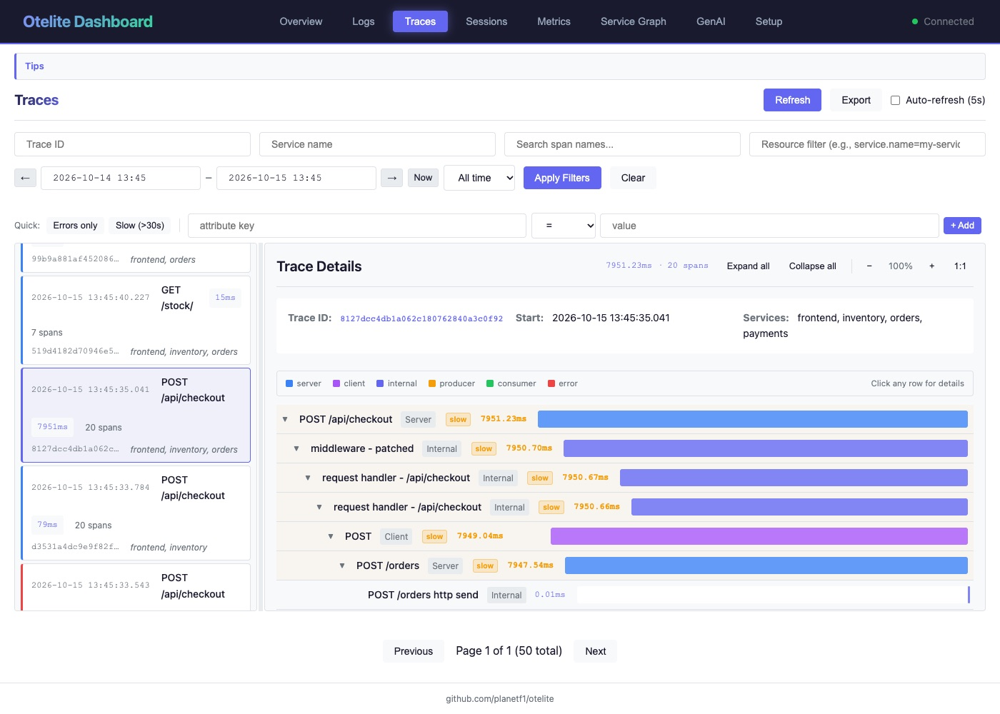
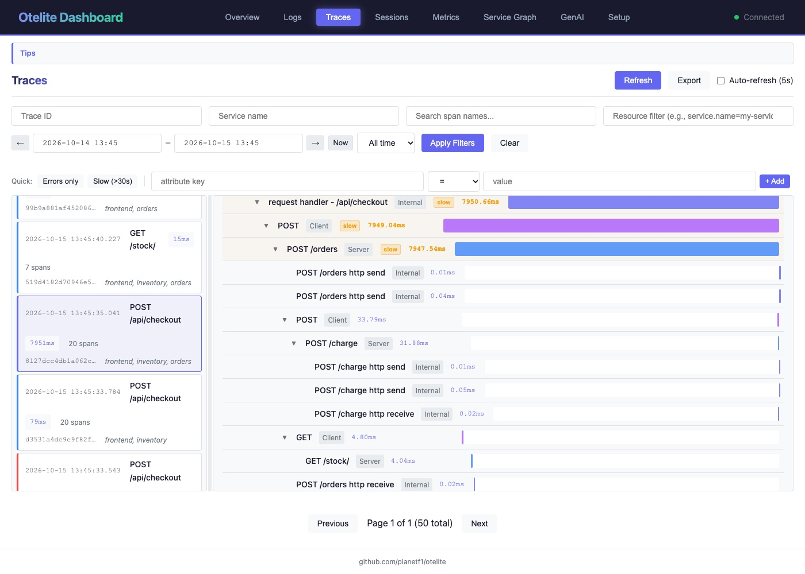
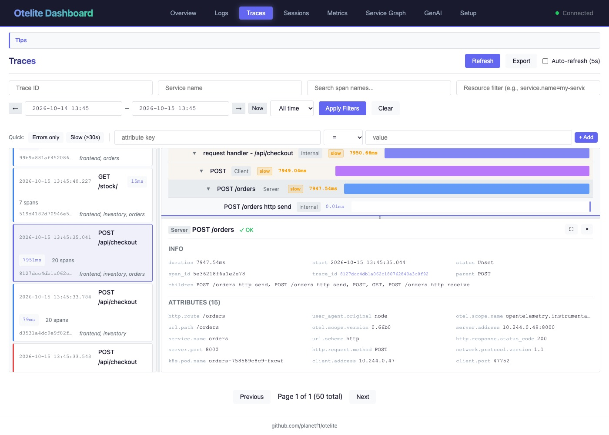
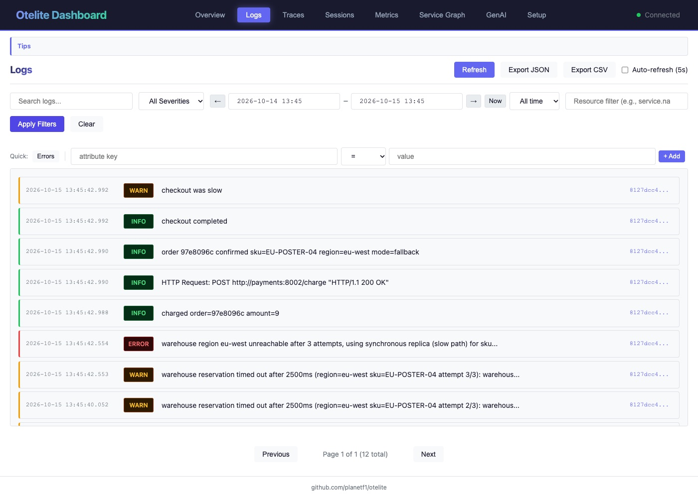

import { Aside, Steps } from '@astrojs/starlight/components';
import Terminal from '../../../../components/Terminal.astro';

**Goal:** go from "users say it is slow" to the root cause, using each
signal for what it is good at.

- A **metric** tells you *that* something is wrong, and how bad.
- A **trace** tells you *where*: which service, which call.
- A **log** tells you *why*: what the code was thinking at that moment.

<Aside type="note">
Every otelite tab freezes its time window when it loads. Tick
**Auto-refresh** or click **Now** then **Apply**.
</Aside>

## 3.1 The metric: is it really slow?

[http://localhost:3000](http://localhost:3000), tab **Metrics**. Type
`request.duration` in the *Filter metrics* box on the left and click
`http.server.request.duration.frontend`.

You get the average request duration (around 1.9 s), the number of
observations, and the **bucket distribution** of the histogram: most requests
in the bucket below 50 ms, a second group in the bucket between 7.5 and 10 s.
Nothing in between.



That is already a lot:

- The problem is real and it is not "the average user". One in four requests
  takes 8 s. The mean alone would say "2 seconds, meh".
- Bimodal means it is not a saturated resource. Saturation smears the whole
  distribution to the right. Something costs a fixed 8 s, or it does not.

Now click `http.server.request.duration.orders` and `.inventory`. Orders:
same picture. Inventory: all under 50 ms.

Also look at `http.client.request.duration.orders` (the call to inventory,
fast), `jvm.cpu.*`, `nodejs.eventloop.*`. CPU fine. Memory fine. Event loop
fine. Welcome to the mystery.

The metric points a finger, but it only knows the HTTP server side of each
service. For the chain of calls you need a trace.

## 3.2 The trace: who is slow?

Tab **Traces**. The duration badge on each card makes slow ones easy to spot:
`7909ms` next to `28ms`. Click a slow one.



The waterfall, top to bottom:

```
POST /api/checkout            frontend   7910 ms   <- the button
  middleware - ...            frontend            (Express internals, noise)
  POST                        frontend   7908 ms   <- outgoing call to orders
    POST /orders              orders     7752 ms   <- orders handling it
      GET                     orders        4 ms   <- outgoing call to inventory
        GET /stock/           inventory     3 ms   <- inventory answering
      POST                    orders       35 ms   <- outgoing call to payments
        POST /charge          payments     32 ms   <- payments answering
```



Read it like this:

- frontend waits 7.9 s for orders. Frontend is innocent.
- orders spends 7.75 s. Of that, 4 ms is the call to inventory and 35 ms the
  call to payments.
- inventory and payments are innocent. The `cache miss` logs were a red herring.
- **7.7 seconds happen inside orders, between the inventory call and the
  payments call, with no span for them.** Auto-instrumentation shows network boundaries. Whatever orders
  does in between is invisible.

Click the `POST /orders` span. Attributes: `service.name=orders`,
`k8s.pod.name`, `http.route`, `server.address`, status code 200, and
`otel.scope.name=opentelemetry.instrumentation.fastapi`, which tells you which
agent produced it. Status OK. From the outside, everything is fine.



Same thing from the terminal, if you prefer:

<Terminal src="otelite/api-traces" title="Slow traces via the otelite API" />

Two options now: read the orders code (small here, 40k lines and three teams
in real life), or ask the logs what happened in that exact request.

## 3.3 The log: why?

In the span details, click the **Trace ID** link. otelite switches to the
Logs tab filtered on that trace. (Or copy the id, go to Logs, and add an
attribute filter `trace_id = <id>`.)

For a slow trace, from orders, in order:

```
INFO  new order request sku=EU-HOODIE-03 qty=1
INFO  HTTP Request: GET http://inventory:8081/stock/EU-HOODIE-03 "HTTP/1.1 200 OK"
WARN  warehouse reservation timed out after 2500ms (region=eu-west sku=EU-HOODIE-03 attempt 1/3): warehouse-eu.internal:9000 did not answer within 2500ms
WARN  warehouse reservation timed out after 2500ms (region=eu-west sku=EU-HOODIE-03 attempt 2/3): ...
WARN  warehouse reservation timed out after 2500ms (region=eu-west sku=EU-HOODIE-03 attempt 3/3): ...
ERROR warehouse region eu-west unreachable after 3 attempts, using synchronous replica (slow path) for sku=EU-HOODIE-03
INFO  order 5f75ec9a confirmed sku=EU-HOODIE-03 region=eu-west mode=fallback
```

And from frontend, same trace id: `checkout started`, `checkout was slow
ms=7912`, `checkout completed`.



<Terminal src="otelite/api-logs" title="All logs of one trace, via the API" />

There it is. 3 attempts × 2.5 s timeout + 400 ms fallback = 7.9 s. The EU
warehouse endpoint is dead. The client retries three times with a long
timeout, falls back, and the order succeeds. HTTP 200. Nobody is paged.

Compare with a fast trace: `reserved US-MUG-02 x1 at us-east (attempt 1)`.
One attempt, 20 ms.

## 3.4 Confirm it is systemic

Logs tab, clear the trace filter, severity **ERROR**. Every error is the same
message, every one is `region=eu-west`. Severity **WARN**: every EU order
produces exactly three. Nothing else is wrong in the system. Full-text search
works too: `eu-west`.

## 3.5 What we learned

| Signal | Question it answered | What it could not tell us |
|--------|---------------------|---------------------------|
| metric | Is it slow? For how many? Since when? | Which call. Why. |
| trace | Which service, which call, how the time splits | What happened inside the gap |
| log | Why: timeouts, retries, fallback, config values | How often, across all users, without grepping |

The trace id ties them together. Without it you would be grepping timestamps
across three services and guessing.

One thing still bothers us: the 7.7 s gap in the trace. The logs explained
it. We would prefer the trace to show it. That is step 4.

<Aside type="tip" title="Terminal people">
otelite has a REST API (`localhost:3000/api/traces`, `/api/logs?trace_id=`,
`/api/logs?severity=ERROR`) and, if you `brew install planetf1/tap/otelite`,
a CLI: `otelite traces list --endpoint http://localhost:3000 --min-duration 5s`
and `otelite tui --endpoint http://localhost:3000`.
</Aside>
