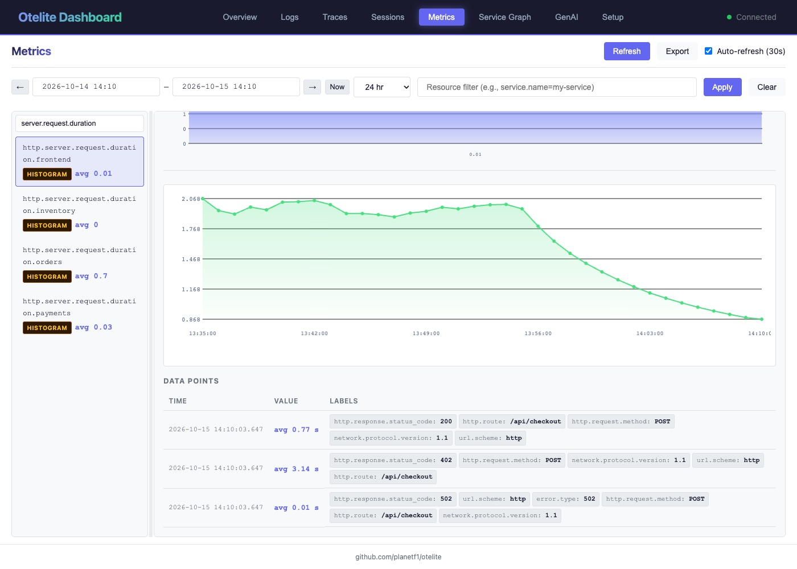

import { Aside } from '@astrojs/starlight/components';
import Terminal from '../../../../components/Terminal.astro';

**Goal:** apply a mitigation, then prove with metric, trace and log that it
worked.

## 5.1 What is the actual fix?

The EU warehouse endpoint is dead. Three things are wrong, in order of how
fast you can fix them:

1. **Retry policy.** 3 attempts with a 2.5 s timeout before giving up means
   every EU order burns 7.9 s to end up in the fallback anyway. Fail fast.
2. **Observability.** Nobody noticed for days because the request returns
   200. An error-rate alert on HTTP status would never fire. A latency SLO on
   p95 would have. The `warehouse.reserve` span from step 4 now gives you an
   error rate to alert on.
3. **The endpoint.** Somebody has to fix `warehouse-eu.internal`. Different
   team, different day.

We do number 1, the on-call mitigation. The warehouse client reads its
settings from the environment, so no rebuild:

```bash
make fix
```

which runs

```bash
kubectl -n shop set env deploy/orders WAREHOUSE_TIMEOUT_MS=250 WAREHOUSE_RETRIES=1
```

<Terminal src="common/fix" title="make fix, then one EU checkout" />

| | before | after |
|---|---|---|
| attempts × timeout | 3 × 2500 ms | 1 × 250 ms |
| fallback replica | 400 ms | 400 ms |
| EU checkout | ~7.9 s | ~0.65 s |

Still a fallback, still logged as an error, still a red span. The user just
stops paying 7.5 s for retries that never succeed.

## 5.2 Prove it with the metric

Metrics tab, `http.server.request.duration.frontend`, bucket size **1 min**.
The average line drops from about 1.9 s to under 0.2 s. The histogram is
cumulative since the pod started, so the old 7.5 to 10 s group stays, but it
stops growing while the 0.5 to 0.75 s bucket starts climbing. Watch the
counts for a minute.



This is the chart you paste in the incident channel.

## 5.3 Prove it with a trace

Traces tab, a fresh `POST /api/checkout` for an EU product, around 650 ms:

```
warehouse.reserve         ERROR   650 ms   region=eu-west mode=fallback max_retries=1
  warehouse.call_primary  ERROR   250 ms   attempt=1
  warehouse.call_fallback         400 ms
```

Still an error, the warehouse is still down. A cheap one.

## 5.4 Prove it with the logs

Logs tab, severity WARN, newest first:

```
warehouse reservation timed out after 250ms (region=eu-west sku=EU-POSTER-04 attempt 1/1)
```

<Terminal src="common/logs-fixed" title="One warning per EU order, 250 ms" />

One warning per EU order instead of three, `250ms` instead of `2500ms`. The
ERROR line is still there. Someone should still fix the endpoint.

## 5.5 Replay

```bash
make unfix     # 2500 ms, 3 retries again
make reset     # back to step 0: no instrumentation, broken, otelite wiped
```

<Aside type="note" title="What to take home">
- Three signals, three questions: *is it slow* (metric), *where* (trace),
  *why* (log). The trace id is the glue.
- Auto-instrumentation is an environment variable per language. Start there.
  Add your own spans where the agents cannot see.
- Returning 200 after a fallback hides outages. Record errors on spans even
  when the request "succeeds".
- Everything in the repository is a template. Swap otelite for your backend,
  swap the shop for your services, keep the Collector.
</Aside>
