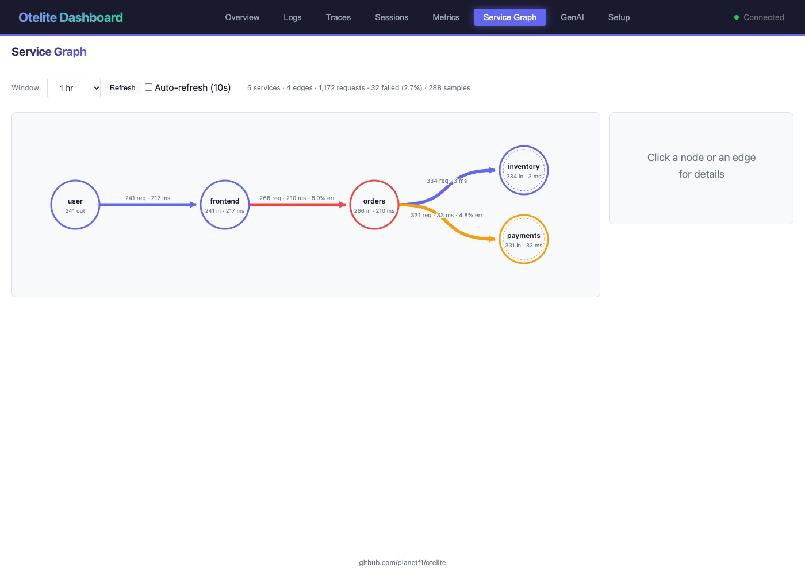
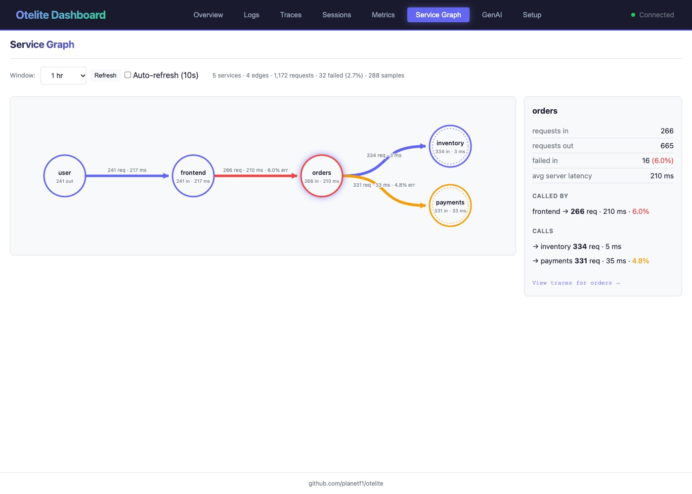

import { Aside } from '@astrojs/starlight/components';

**Goal:** a picture of who calls whom, with request rate, error rate and
latency on every arrow, without anyone drawing it by hand.

## 6.1 Where the map comes from

You have traces. Every trace is a tree of spans, and every client span in
one service has a matching server span in the next. Pair them up across all
traces and you have the edges of a graph. That is exactly what the
[`service_graph` connector](https://github.com/open-telemetry/opentelemetry-collector-contrib/tree/main/connector/servicegraphconnector)
does inside the Collector.

A **connector** is a Collector component that is the end of one pipeline and
the start of another. Here it consumes the traces pipeline and produces a
metrics pipeline:

```yaml title="otelite/k8s/stack/otel-collector.yaml (the connector part)" {2-7,13,16-19}
connectors:
  service_graph:
    metrics_flush_interval: 10s
    store:
      ttl: 10s
      max_items: 5000
    latency_histogram_buckets: [10ms, 50ms, 100ms, 250ms, 500ms, 1s, 2.5s, 5s, 10s]

service:
  pipelines:
    traces:
      receivers: [otlp]
      processors: [transform/otelite-span-service, batch]
      exporters: [otlp/otelite, service_graph]      # traces also go into the connector
    metrics/service_graph:
      receivers: [service_graph]                     # ...which emits metrics here
      processors: [batch]
      exporters: [otlp/otelite]
```

The connector emits four metrics, one series per `(client, server)` pair:

| Metric | Type | Meaning |
|--------|------|---------|
| `traces_service_graph_request_total` | counter | requests from client to server |
| `traces_service_graph_request_failed_total` | counter | of which failed (span status ERROR) |
| `traces_service_graph_request_server` | histogram | seconds, as seen by the server |
| `traces_service_graph_request_client` | histogram | seconds, as seen by the client |

Grafana draws these natively. otelite did not, so this workshop adds a
**Service Graph** tab to it: `GET /api/servicegraph` reads the samples in the
window, takes the delta of the cumulative counters, and the page lays the
nodes out left to right. The change is small, read it in the
[otelite fork](https://github.com/iblancasa/otelite/tree/feat/service-graph):
one Rust file, one JavaScript file. The image you are running,
`ghcr.io/iblancasa/otelite:feat-service-graph`, is built from that branch.

## 6.2 Look at it

The connector is already in the Collector you deployed in step 1 and the
otelite image already has the tab. Open
[http://localhost:3000/#servicegraph](http://localhost:3000/#servicegraph).

```
                                                              ┌── 334 req · 3 ms ──▶ inventory
 user ── 241 req · 217 ms ──▶ frontend ── 266 req · 210 ms · 6% err ──▶ orders ──┤
                                                              └── 331 req · 33 ms · 5% err ──▶ payments
```



The numbers above are from after step 5. If you come here with the
warehouse still broken, the `frontend → orders` arrow reads around 2 s
instead of 210 ms. Same graph, different label.

Five nodes, four arrows. `orders` fans out to `inventory` and `payments`. `user` is not a service: the connector invents a
virtual client for server spans that have no caller, which is what a browser
or the load generator looks like from inside the cluster. Arrow width is request volume. Colour is error
rate: indigo for none, amber for some, red above 5 percent. Labels carry the
average server-side latency.

Click `orders`. The side panel lists who calls it, what it calls, the
request counts and latencies for each.

 Click the arrow from `frontend` to
`orders`: window delta versus cumulative total, client-side versus
server-side latency, last sample time.

What you should notice:

- Before the fix, the `frontend → orders` edge averages around 2 s while
  `orders → inventory` averages 5 ms. Same conclusion as step 3, zero
  clicks. After the fix it drops to about 200 ms, which is what the
  screenshot shows.
- The `orders → payments` edge is amber: about 8 percent of charges come
  back `402 card declined` (three posters on one card trip the per-order
  limit). A 4xx on a client span is an error in OpenTelemetry's HTTP
  conventions, so the connector counts it as failed, and the same requests
  fail on `frontend → orders` one hop up. Click the edge for the numbers.
- The slow warehouse never shows as an error here, before or after step 4.
  `warehouse.reserve` is an internal span, not a client/server pair, and the
  connector only pairs those. If the warehouse were a real remote call with
  a failing client span, the edge would turn red and a virtual
  `warehouse-eu.internal` node would appear.
- The `frontend → orders` arrow is red (6 percent): every declined card is
  a 402 all the way up. `orders → payments` is amber (5 percent): same
  failures, seen one hop down. `user → frontend` stays indigo because the
  frontend answers the browser with a proper 402, which is not an error for
  a server span.

## 6.3 Why this matters

- **Topology for free.** Nobody maintains an architecture diagram. The graph
  is whatever the traces say it is, right now.
- **Blast radius.** Click a node and see everything upstream of it before you
  restart it.
- **Virtual nodes.** Calls to things nobody instrumented (databases, SaaS
  APIs, that one Perl service) still show up as nodes, inferred from the
  client span's `peer.service`, `db.name` or `db.system`.

<Aside type="note" title="No traces, no graph">
The graph is derived from traces. Before step 2 the tab shows an empty state
with the Collector snippet. Instrument first, then come back.

If you ever see a node called `unknown`, a client span never met its server
span: the callee was restarting, or is not instrumented. The config names
such virtual nodes after `server.address` so a short inventory outage shows
up as extra traffic to `inventory`, not as a stranger.
</Aside>

<Aside type="note" title="Caveats, stated plainly">
- The connector needs both halves of an edge in the same Collector instance.
  With several Collectors behind a load balancer, pair them with the
  `loadbalancing` exporter first, keyed by trace id.
- Spans older than `store.ttl` that never found their pair are dropped and
  counted in `traces_service_graph_unpaired_spans_total`. Long-running
  requests need a longer TTL.
- Counters are cumulative since the Collector started. otelite's endpoint
  reports the delta inside the window, and falls back to the cumulative
  total when only one sample is in range.
</Aside>

## 6.4 Try from the terminal

```bash
curl -s 'localhost:3000/api/servicegraph' | python3 -c '
import sys, json
g = json.load(sys.stdin)
for e in g["edges"]:
    lat = f"{e['avg_server_seconds']*1000:.0f} ms" if e["avg_server_seconds"] is not None else "-"
    print(f"{e['client']:>10} -> {e['server']:<10} {e['requests']:>6.0f} req  {e['error_rate']*100:4.1f}% err  {lat}")'
```

Add `?start_time=<ns>&end_time=<ns>` for a different window. The default is
the last hour.
