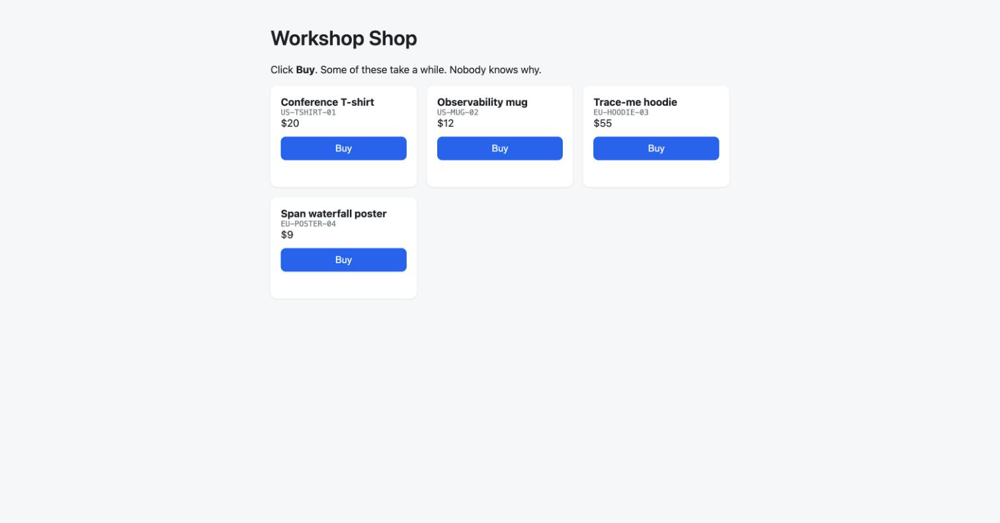
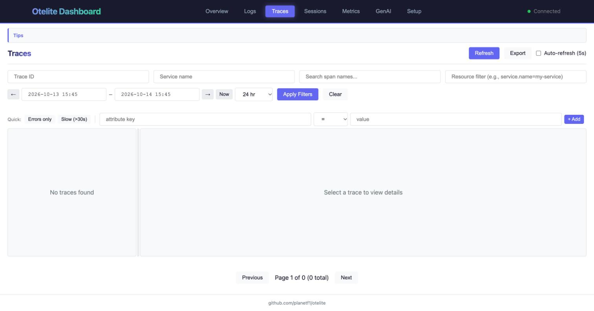

import { Aside, Steps } from '@astrojs/starlight/components';
import Terminal from '../../../components/Terminal.astro';

**Goal:** see the problem with your own eyes, and see that you have nothing
to find it with.

## 0.1 Is everything running?

```bash
make status
```

Every pod in `shop` and `observability` should be `Running`. If not, go to
[Prepare](/otel-workshop/prepare/) first.

## 0.2 Reproduce the complaint

Open [http://localhost:8080](http://localhost:8080). Click **Buy** on the
hoodie or the poster. Watch the counter. Then click **Buy** on the t-shirt or
the mug. Instant.



Same thing from the terminal:

```bash
curl -s -w ' -> %{time_total}s\n' -X POST localhost:8080/api/checkout \
  -H 'content-type: application/json' -d '{"sku":"US-MUG-02","qty":1}'

curl -s -w ' -> %{time_total}s\n' -X POST localhost:8080/api/checkout \
  -H 'content-type: application/json' -d '{"sku":"EU-HOODIE-03","qty":1}'
```

<Terminal src="checkout" title="One fast checkout, one slow one" />

A load generator is already hitting the shop in the background: 3 workers,
about one in four buys an EU product. There is always traffic.

```bash
make traffic-logs     # sku -> status in ms, live
make traffic-heavy    # 10 workers, 50% EU, busier dashboards
make traffic-off      # silence, so you can click Buy and find your own request
make traffic-on       # back to default
```

<Terminal src="traffic" title="make traffic-logs" />

## 0.3 What do we know so far?

Look where everybody looks first:

```bash
make logs-frontend
make logs-orders
make logs-inventory
```

<Terminal src="logs-before" title="The three services' logs, before instrumentation" />

- **frontend** says `checkout was slow ... ms: 7912`. A symptom, not a cause.
- **orders** looks busy. Nothing jumps out at a glance.
- **inventory** logs `cache miss` lines. Suspicious? Keep that thought.

The orders log does contain the answer, buried between 20 other lines per
second. You only know that because you are reading a workshop page. In a real
system with 40 services and 2000 lines per second, you would not.

CPU? kind does not ship metrics-server, so `kubectl top` does not work. Trust
us for now: it is fine. You will see it in a histogram in step 3.

## 0.4 Look at otelite

Open [http://localhost:3000](http://localhost:3000). The Overview counts zero
traces. Logs, Traces, Metrics: empty. The services do not send anything yet.



<Aside type="note">
This is the honest starting point of most slow-API tickets: a symptom in one
log, three suspects, no data. Next: what we deployed to fix that.
</Aside>
